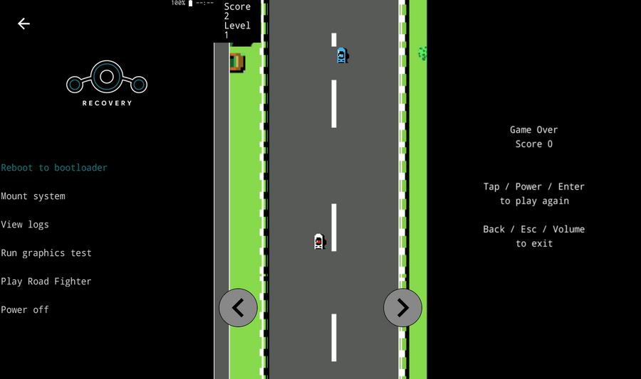

# Road Fighter in the Nexus 5X recovery

[Road-Fighter-Compose](https://github.com/kaiwalyakhasnis/Road-Fighter-Compose), a Jetpack Compose
game, ported to C++ and built **into LineageOS 15.1 recovery** for the Nexus 5X (bullhead). It
draws with recovery's own tiny graphics library, **minui**, runs entirely in userspace with no
Android framework, and starts as soon as recovery boots.

Also included: a **QEMU setup** that boots the real bullhead kernel and the real recovery ramdisk
on QEMU's `virt` board, with a live screen and a working keyboard. That's how the game was
developed and tested.



## What's here

| Path | What |
|---|---|
| [`patches/bootable_recovery/`](patches/bootable_recovery) | 2 commits for `bootable/recovery` (LineageOS `lineage-15.1`): the game, the menu entry, auto-start, `PollInputEvent()` |
| [`patches/qemu-kernel/`](patches/qemu-kernel) | 5 patches for a **copy** of `kernel/lge/bullhead`, only for QEMU: simplefb/ramfb display, virtio-input, two fixes |
| [`qemu/`](qemu) | `setup.sh` (one-shot QEMU setup), run scripts, device-tree generator, screenshot tool, kernel config fragment |
| [`docs/`](docs) | How it works (see below) |
| [`manifest-pinned.xml`](manifest-pinned.xml) | The exact revisions the patches apply to |

## Docs

1. [Porting from Compose to recovery](docs/01-porting-from-compose.md): what maps to what, assets, rendering, input, how it hooks into recovery
2. [minui, recovery, and why everything is userspace](docs/02-minui-and-userspace.md)
3. [Which drivers are involved](docs/03-drivers.md): on the phone and in QEMU
4. [Running the bullhead kernel and recovery in QEMU](docs/04-qemu-setup.md): every workaround and why

## Build the recovery

In a LineageOS 15.1 tree set up for bullhead:

```bash
cd bootable/recovery
git am /path/to/nexus5x-recovery-roadfighter/patches/bootable_recovery/*.patch
cd ../..
source build/envsetup.sh && lunch lineage_bullhead-userdebug
mka recoveryimage
```

This produces `out/target/product/bullhead/recovery.img` and `ramdisk-recovery.img`.

## Play it on a Nexus 5X, without flashing

With an unlocked bootloader:

```bash
adb reboot bootloader
fastboot boot out/target/product/bullhead/recovery.img
```

`fastboot boot` runs the image from RAM once. No partition is written, and the next reboot is your
normal system. (Recovery itself writes its usual log to `/cache/recovery/` as on every recovery
boot.) To keep it, `fastboot flash recovery out/target/product/bullhead/recovery.img`.

| | Steer | Play again | Exit to the recovery menu |
|---|---|---|---|
| Phone | Volume Up / Down, or tap the left/right half | Power, or tap | Swipe left, or a volume key on the Game Over screen |
| QEMU | ← / → | Enter / Space | Esc |

The game is also in **Advanced → Play Road Fighter**. It auto-starts only when recovery is entered
without a command. OTA installs, wipes and sideloads run as usual.

## Play it in QEMU

```bash
sudo apt install qemu-system-arm            # QEMU 8.2 tested
LINEAGE=~/path/to/lineage qemu/setup.sh     # once, builds the QEMU kernel into ~/bullhead-qemu
LINEAGE=~/path/to/lineage qemu/run-recovery.sh
```

Recovery boots in about 30–45 s, then the game starts. Click into the window and press Enter to
play. Details and every QEMU workaround: [docs/04-qemu-setup.md](docs/04-qemu-setup.md).

## How it works, in one picture

```
userspace   /sbin/recovery  (one static binary started by init from the recovery ramdisk)
            ├─ recovery menus (screen_ui.cpp)        └─ roadfighter.cpp  ── PollInputEvent()
            └─ minui  gr_* ───────────────┐              ev_* ──────────────┐
──────────────────────────────────────────┼──────────────────────────────────┼──────────
kernel      /dev/graphics/fb0             │              /dev/input/event*   │
  phone:    Qualcomm MDSS fb → DSI panel ─┘              Synaptics RMI4 touch, gpio-keys, qpnp power key
  QEMU:     simplefb + ramfb (patches)                   virtio-input (patch)
```

No GPU, no SurfaceFlinger, no Java: every pixel is computed on the CPU inside `/sbin/recovery`
and written to the framebuffer through `mmap`.

## Status

* QEMU: tested. Menu entry, auto-start, scrolling road, steering, scoring, Game Over, restart and
  exit all checked with QEMU screen captures. `qemu/setup.sh` tested from a clean checkout.
* Nexus 5X: the image RAM-boots with `fastboot boot`. Levels 2–6 (faster road, tinted verges) and
  touch steering haven't been checked on a screen capture yet.

## Credits and licenses

* Game design and assets: [Road-Fighter-Compose](https://github.com/kaiwalyakhasnis/Road-Fighter-Compose).
* `bootable/recovery` patches: Apache 2.0, like AOSP recovery.
* Kernel patches: GPL-2.0, like the Linux kernel. `virtio_input.c` follows the upstream Linux 4.1
  driver's structure.
