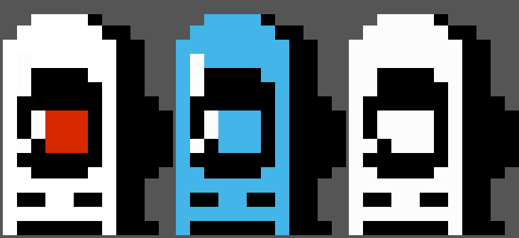

# 1. Porting Road Fighter from Jetpack Compose to recovery

The original game is [Road-Fighter-Compose](https://github.com/kaiwalyakhasnis/Road-Fighter-Compose):
a Kotlin app built from Jetpack Compose UI and a small Redux-style store (state, reducers, middleware).
None of that exists in recovery: there is no ART/JVM, no Android framework, no Compose runtime, no GPU
stack. Recovery is one static C++ binary drawing pixels with
[minui](02-minui-and-userspace.md). So the port keeps the **game rules** and redoes the
**runtime**: layout, animation, rendering and input.

The result is `roadfighter/roadfighter.cpp` (about 490 lines) inside `bootable/recovery`.

## What maps to what

| Compose version | Recovery version |
|---|---|
| `GameStore` + reducers (`ScoreReducer`, `LevelReducer`, `GameControlReducer`, ...) and middleware | Plain fields in `class Game`, changed in `Game::Update()` / `Game::Run()` |
| `rememberInfiniteTransition` + `animateFloat(0→1, tween(speed))`, the "game loop" | `anim_` advanced by `dt / kLevelSpeedMs[level]` each frame; a frame every ~33 ms |
| `BusyRoad`: a `Row` of three `Image`s with weights 1 : 2.5 : 0.5, `ContentScale.FillBounds`, two copies offset by the animation | Three road PNGs scaled once to `W/4`, `W·5/8`, `W/8` × screen height; each frame two copies are copied at `y = H·anim` and `y − H` |
| `ColorFilter.tint(color, BlendMode.Color)` on the verges for levels 2/3/5/6 | `tint_color_blend()`: the same W3C "color" blend (tint hue and saturation, image luminosity), pre-computed once per level at start |
| `BlueCar`: `absoluteOffset(x = random 120..250dp, y = H·anim)`, new x each cycle, `animateDpAsState` spring | `blue_target_x_` picked on wrap-around; `blue_x_` eases towards it with an exponential approach |
| `PlayerCar`: `BottomCenter`, `paddingFromBaseline(bottom = 250dp)`, `offset(x = playerOffset)` | Same numbers: x = center + offset, y = H − 250dp − car height |
| `onGloballyPositioned { boundsInRoot() }` + `Rect.overlaps()` for collisions | Rectangles computed directly; `RectF::overlaps()` copies Compose's `Rect.overlaps()` |
| Score when the blue car's top passes the player's top (`hasPassedPlayerCar`) | Same check with a `blue_counted_` flag |
| `LevelsMiddleware`: `score % 25 == 0` → next level (max 6), speeds 1500/1400/1300/1200/1000/750 ms | Identical table (`kLevelSpeedMs`, `kLevelTint`) |
| `GameControls`: two 75dp gray round `IconButton`s, `KeyboardArrowLeft/Right`, ±20dp per click | `make_button()` draws the same circle with the Material chevron path; volume keys, arrow keys or a tap on a screen half move ±20dp |
| `DashBoard`: black box with "Score / N / Level / N", 20sp | `gr_fill()` + `gr_text()` with recovery's menu font |
| `GameOver`: "Game Over / Score N / Tap anywhere to restart" | Same screen, plus how to exit, since recovery has no back stack |

## Units: dp without Android's density

All layout numbers in the Compose code are in dp. Recovery has no `DisplayMetrics`, so the port
defines **1 dp = screen width / 411.43**: the Nexus 5X is 1080 px wide at 420 dpi, which is
411.43 dp. On bullhead (and in QEMU, which uses the same 1080×1920 framebuffer) that gives exactly
2.625 px/dp, the phone's real density, and the game keeps its proportions on other screens.

## Assets

* **Road**: `road_left.png`, `road_center.png`, `road_right.png` are copied unchanged from the app.
  Their first row is a dark line, which the Compose code hides by overlapping the two copies by 2dp.
  The port drops that row at load time instead.
* **Cars**: `player_car.xml` and `blue_car.xml` are VectorDrawables. minui can't render vectors, so
  `roadfighter/tools/vec2png.py` turns them into PNGs at build-preparation time. They are pixel
  art made only of axis-aligned rectangles, so the script computes the exact nonzero-winding fill
  per pixel instead of going through an SVG renderer. ImageMagick's SVG renderer got the holes in
  the paths wrong.

  

  The current `player_car.xml` is a white car with a red windshield. The red car in the app's old
  `output.gif` came from an earlier version of the drawable.
* The PNGs are installed into the recovery ramdisk at **`/etc/roadfighter/`** by
  `roadfighter/Android.mk` (prebuilt modules, required by the `recovery` module). They can't go
  under `/res`, because the recovery image build wipes `res/*` and recopies the stock resources
  (`build/make/core/Makefile`, the `rm -rf $(TARGET_RECOVERY_ROOT_OUT)/res/*` line).

## Rendering: why the game composes its own frames

minui's `gr_blit()` is an opaque `memcpy`, and it skips the whole blit if any corner would be
off-screen. A game needs both transparency (car sprites on the road) and clipping (the road scrolls
off the bottom). So each frame is built in a private RGBA buffer:

```
Render():
  road (opaque row copies, clipped)  →  blue car, player car, buttons (alpha blend, clipped)
  gr_blit(whole buffer)  →  gr_fill/gr_text for the dashboard  →  gr_flip()
```

minui's draw buffer is R,G,B,X on bullhead (`TARGET_RECOVERY_PIXEL_FORMAT` unset), the same order as
the game's buffer. For devices built with `ABGR_8888`/`BGRA_8888`, `Android.mk` defines
`ROADFIGHTER_BGR` and the frame is swapped before `gr_blit()`, mirroring minui's own `png_set_bgr()`.

## Input: a non-blocking read

Recovery's input thread turns kernel events into a queue of key presses and touch taps.
The menu reads it with `RecoveryUI::WaitInputEvent()`, which blocks for up to 120 s and redraws the
menu or dims the backlight while it waits. A game can't use that, so the patch adds
`RecoveryUI::PollInputEvent(event, timeout_ms)`: same queue, but it waits at most until the next
frame and never touches the screen.

Recovery registers a key on **release**, and holding a key does not repeat. That matches the app,
where every click on an arrow button is one 20dp step.

| | Steer | Play again | Exit to the recovery menu |
|---|---|---|---|
| Phone | Volume Up / Down, or tap the left/right half of the screen | Power, or tap | Swipe left (recovery turns it into Back), or a volume key on the Game Over screen |
| QEMU keyboard | ← / → | Enter / Space | Esc |

## Hooking it into recovery

* `device.h` / `device.cpp`: new `Device::ROAD_FIGHTER` action and an Advanced menu item
  "Play Road Fighter".
* `recovery.cpp`: the action calls `run_road_fighter(ui)`. Patch 0002 also calls it right before
  the menu when recovery was entered **without a command** (`status == INSTALL_NONE`), so the game
  is the first thing you see. OTA installs, wipes and sideloads run as before, without the game.
* When the game returns, recovery carries on to `prompt_and_wait()`, which redraws the normal menu.
